# Datenmodell

> **Automatisch erzeugt** aus dem Prisma-Schema mit `npm run db:erd` – nicht von Hand bearbeiten.
> Nach jeder Schema-Änderung neu erzeugen; `test/unit/datenmodell.test.ts` schlägt sonst fehl.

12 Tabellen, 23 Beziehungen, 9 Enums.

## Lesehilfe

- **PK** Primärschlüssel, **FK** Fremdschlüssel, **UK** eindeutig. `unique(a, b)` = gemeinsam eindeutig.
- In Anführungszeichen: `optional` (darf leer sein), Datenbank-Typ (z.B. `VarChar(80)`), Standardwert.
- Linien: `||` genau einer, `|o` keiner oder einer, `o{` keiner oder viele. Die Beschriftung ist die Fremdschlüssel-Spalte.
- Felder mit Enum-Typ (z.B. `Role`): erlaubte Werte unter [Enums](#enums).

## Diagramm

```mermaid
erDiagram
  User {
    String id PK "Uuid; default uuid(7)"
    String email UK
    String displayName "VarChar(40)"
    String passwordHash
    Role role "default user"
    Boolean mustChangePassword "default false"
    DateTime blockedAt "optional"
    DateTime blockedUntil "optional"
    String blockReason "optional; VarChar(500)"
    String blockedById FK "optional; Uuid"
    DateTime createdAt "default now()"
    DateTime lastLoginAt "optional"
  }
  Session {
    String id PK
    String userId FK "Uuid"
    Boolean remember
    DateTime expiresAt
    DateTime lastSeenAt "default now()"
    DateTime createdAt "default now()"
  }
  AuditLog {
    BigInt id PK "default autoincrement()"
    DateTime createdAt "default now()"
    AuditEvent event
    String actorId FK "optional; Uuid"
    String targetId FK "optional; Uuid"
    String ip "optional"
    String requestId "optional"
    Json details "optional"
  }
  Ingredient {
    String id PK "Uuid; default uuid(7)"
    String sourceLocale "VarChar(5)"
    DateTime createdAt "default now()"
    DateTime hiddenAt "optional"
    String hiddenById FK "optional; Uuid"
    String hiddenReason "optional; VarChar(500)"
    String mergedIntoId FK "optional; Uuid"
    DateTime mergedAt "optional"
  }
  IngredientVersion {
    String id PK "Uuid; default uuid(7)"
    String ingredientId FK "Uuid; unique(ingredientId, version)"
    Int version "unique(ingredientId, version)"
    Boolean isCurrent "default false"
    Caffeine caffeine "default unknown"
    Int brewTempC "optional; SmallInt"
    Int brewSeconds "optional; SmallInt"
    String authorId FK "optional; Uuid"
    String note "optional; VarChar(200)"
    DateTime createdAt "default now()"
    Int revertedTo "optional; SmallInt"
    String bulkRevertOfId FK "optional; Uuid"
  }
  IngredientVersionTranslation {
    String versionId PK, FK "Uuid"
    String locale PK "VarChar(5)"
    String name "VarChar(80)"
    String nameKey
    String description "optional; VarChar(2000)"
  }
  Tea {
    String id PK "Uuid; default uuid(7)"
    String sourceLocale "VarChar(5)"
    String ownerId FK "optional; Uuid"
    DateTime createdAt "default now()"
    DateTime hiddenAt "optional"
    String hiddenById FK "optional; Uuid"
    String hiddenReason "optional; VarChar(500)"
    String mergedIntoId FK "optional; Uuid"
    DateTime mergedAt "optional"
  }
  TeaVersion {
    String id PK "Uuid; default uuid(7)"
    String teaId FK "Uuid; unique(teaId, version)"
    Int version "unique(teaId, version)"
    Boolean isCurrent "default false"
    Visibility visibility "default private"
    TeaKind kind
    String brand "optional; VarChar(80)"
    String brandKey "default ''"
    Caffeine caffeine "default unknown"
    Int brewTempC "optional; SmallInt"
    Int brewSeconds "optional; SmallInt"
    String authorId FK "optional; Uuid"
    String note "optional; VarChar(200)"
    DateTime createdAt "default now()"
    Int revertedTo "optional; SmallInt"
    String bulkRevertOfId FK "optional; Uuid"
    String mergedIngredientId FK "optional; Uuid"
  }
  TeaVersionTranslation {
    String versionId PK, FK "Uuid"
    String locale PK "VarChar(5)"
    String name "VarChar(80)"
    String nameKey
    String description "optional; VarChar(2000)"
  }
  TeaVersionIngredient {
    String versionId PK, FK "Uuid; unique(versionId, ingredientId)"
    Int position PK "SmallInt"
    String ingredientId FK "Uuid; unique(versionId, ingredientId)"
    Int percent "optional; SmallInt"
  }
  Report {
    String id PK "Uuid; default uuid(7)"
    CatalogType entityType
    String entityId "Uuid"
    String reporterId FK "optional; Uuid"
    ReportReason reason
    String comment "optional; VarChar(500)"
    String duplicateOfId "optional; Uuid"
    ReportStatus status "default open"
    String resolvedById FK "optional; Uuid"
    DateTime resolvedAt "optional"
    String resolutionNote "optional; VarChar(500)"
    DateTime createdAt "default now()"
  }
  CatalogEvent {
    BigInt id PK "default autoincrement()"
    CatalogType entityType
    String entityId "Uuid"
    CatalogEventKind kind
    String actorId FK "optional; Uuid"
    String reason "optional; VarChar(500)"
    String targetId "optional; Uuid"
    DateTime createdAt "default now()"
  }
  User |o--o{ User : "blockedById"
  User ||--o{ Session : "userId"
  User |o--o{ AuditLog : "actorId"
  User |o--o{ AuditLog : "targetId"
  User |o--o{ Ingredient : "hiddenById"
  Ingredient |o--o{ Ingredient : "mergedIntoId"
  Ingredient ||--o{ IngredientVersion : "ingredientId"
  User |o--o{ IngredientVersion : "authorId"
  User |o--o{ IngredientVersion : "bulkRevertOfId"
  IngredientVersion ||--o{ IngredientVersionTranslation : "versionId"
  User |o--o{ Tea : "ownerId"
  User |o--o{ Tea : "hiddenById"
  Tea |o--o{ Tea : "mergedIntoId"
  Tea ||--o{ TeaVersion : "teaId"
  User |o--o{ TeaVersion : "authorId"
  User |o--o{ TeaVersion : "bulkRevertOfId"
  Ingredient |o--o{ TeaVersion : "mergedIngredientId"
  TeaVersion ||--o{ TeaVersionTranslation : "versionId"
  TeaVersion ||--o{ TeaVersionIngredient : "versionId"
  Ingredient ||--o{ TeaVersionIngredient : "ingredientId"
  User |o--o{ Report : "reporterId"
  User |o--o{ Report : "resolvedById"
  User |o--o{ CatalogEvent : "actorId"
```

## Beziehungen

| Fremdschlüssel | zeigt auf | Pflicht/optional | beim Löschen des Ziels |
|---|---|---|---|
| `User.blockedById` | `User` | optional | `SetNull` |
| `Session.userId` | `User` | Pflicht | `Cascade` |
| `AuditLog.actorId` | `User` | optional | `SetNull` |
| `AuditLog.targetId` | `User` | optional | `SetNull` |
| `Ingredient.hiddenById` | `User` | optional | `SetNull` |
| `Ingredient.mergedIntoId` | `Ingredient` | optional | `Restrict` |
| `IngredientVersion.ingredientId` | `Ingredient` | Pflicht | `Cascade` |
| `IngredientVersion.authorId` | `User` | optional | `SetNull` |
| `IngredientVersion.bulkRevertOfId` | `User` | optional | `SetNull` |
| `IngredientVersionTranslation.versionId` | `IngredientVersion` | Pflicht | `Cascade` |
| `Tea.ownerId` | `User` | optional | `SetNull` |
| `Tea.hiddenById` | `User` | optional | `SetNull` |
| `Tea.mergedIntoId` | `Tea` | optional | `Restrict` |
| `TeaVersion.teaId` | `Tea` | Pflicht | `Cascade` |
| `TeaVersion.authorId` | `User` | optional | `SetNull` |
| `TeaVersion.bulkRevertOfId` | `User` | optional | `SetNull` |
| `TeaVersion.mergedIngredientId` | `Ingredient` | optional | `Restrict` |
| `TeaVersionTranslation.versionId` | `TeaVersion` | Pflicht | `Cascade` |
| `TeaVersionIngredient.versionId` | `TeaVersion` | Pflicht | `Cascade` |
| `TeaVersionIngredient.ingredientId` | `Ingredient` | Pflicht | `Restrict` |
| `Report.reporterId` | `User` | optional | `SetNull` |
| `Report.resolvedById` | `User` | optional | `SetNull` |
| `CatalogEvent.actorId` | `User` | optional | `SetNull` |

`Cascade`: abhängige Zeilen werden mitgelöscht · `SetNull`: Verweis wird geleert · `Restrict`: Löschen ist verboten, solange es Verweise gibt.

### Verweise ohne Fremdschlüssel

Diese Spalten zeigen auf eine Zutat **oder** einen Tee; welche Tabelle, sagt `entityType` (`CatalogType`). Ein echter Fremdschlüssel geht nicht, weil es zwei Zieltabellen sind. Zutaten und öffentliche Tees werden nie gelöscht.

| Spalte | zeigt auf |
|---|---|
| `Report.entityId` | gemeldete Zutat bzw. gemeldeter Tee |
| `Report.duplicateOfId` | bei `reason = duplicate`: der Eintrag, von dem es ein Duplikat ist (gleicher `entityType`) |
| `CatalogEvent.entityId` | Zutat bzw. Tee, um den es geht |
| `CatalogEvent.targetId` | beim Zusammenführen: der Zieleintrag |

## Enums

| Enum | Werte |
|---|---|
| `Role` | `user`, `moderator`, `admin` |
| `AuditEvent` | `USER_REGISTERED`, `LOGIN_SUCCEEDED`, `LOGIN_FAILED`, `LOGOUT`, `PASSWORD_CHANGED`, `PASSWORD_RESET_BY_ADMIN`, `ROLE_CHANGED`, `ADMIN_BOOTSTRAPPED`, `INGREDIENT_CREATED`, `INGREDIENT_UPDATED`, `TEA_CREATED`, `TEA_UPDATED`, `TEA_PUBLISHED`, `TEA_DELETED`, `INGREDIENT_REVERTED`, `TEA_REVERTED`, `REPORT_CREATED`, `REPORT_RESOLVED`, `INGREDIENT_MERGED`, `TEA_MERGED`, `INGREDIENT_HIDDEN`, `INGREDIENT_RESTORED`, `TEA_HIDDEN`, `TEA_RESTORED`, `USER_BLOCKED`, `USER_UNBLOCKED`, `BULK_REVERT` |
| `Caffeine` | `yes`, `no`, `unknown` |
| `TeaKind` | `bought`, `blended` |
| `Visibility` | `private`, `public` |
| `CatalogType` | `ingredient`, `tea` |
| `ReportReason` | `duplicate`, `wrong_info`, `spam`, `inappropriate`, `other` |
| `ReportStatus` | `open`, `resolved`, `rejected` |
| `CatalogEventKind` | `hidden`, `restored`, `merged` |

## Nur in SQL

Einige Datenbankobjekte kennt Prisma nicht; sie stehen nur in den Migrationen und deshalb nicht im Diagramm. Die Liste steht in der [README](../README.md#migrationen) unter „Migrationen“.
